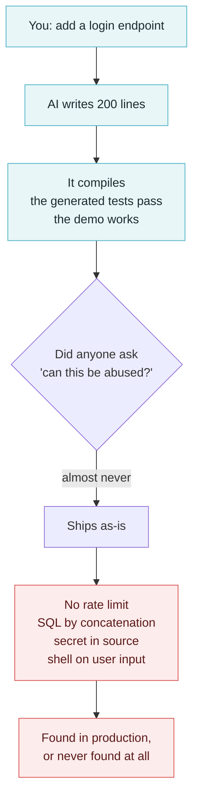
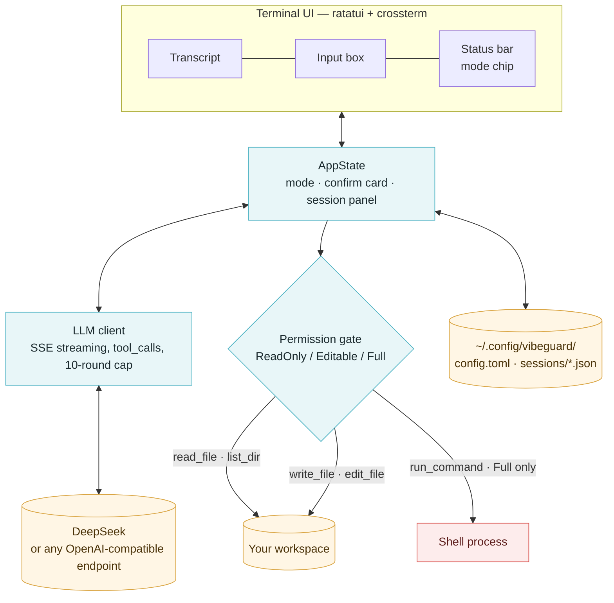
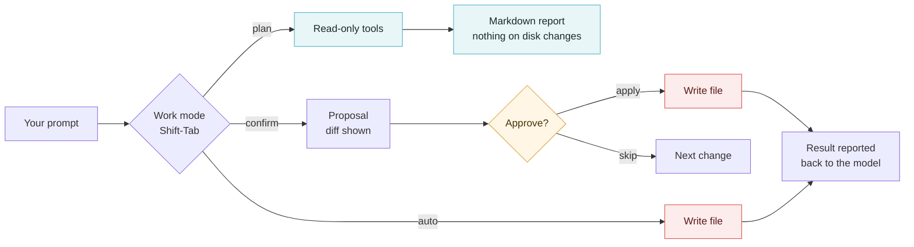

# VibeGuard — Handoff

**AI writes the code. Nobody asks whether it can be abused. That is the gap this tool is built around.**

[中文文档](HANDOFF.zh-CN.md) · English


| | |
|---|---|
| Version | `0.1.0` |
| Runtime | Rust 2024, single binary, no daemon |
| Model | DeepSeek by default, any OpenAI-compatible endpoint |
| Storage | `~/.config/vibeguard/` — config plus one JSON file per conversation, mode `0600` |
| Last updated | 2026-10-23 |

---

## 1. Why this exists

I build most of my projects by talking to an AI. It is genuinely fast — a feature that used to
take an afternoon lands in twenty minutes. What I kept noticing afterwards is that the *shape*
of the resulting code is optimistic: it does the happy path beautifully and treats the unhappy
path as someone else's problem.

The same defect classes showed up again and again in my own repos:

- **No rate limiting** on login, signup, password-reset. Nothing stops a script from trying ten
  thousand passwords.
- **SQL built by string concatenation** — `"SELECT * FROM users WHERE id = " + id` — because it
  reads more naturally than a parameterised query.
- **Secrets inline** in source: an API key pasted straight into a config file that then gets
  committed, because "I'll move it to an env var later".
- **`shell=True`, `eval`, `exec`** on values that came from a request, because the shortest path
  from "run this" to "it works" goes through a shell string.
- **Missing authorization** on newly added endpoints. The AI happily adds `/api/admin/export`
  and forgets that the route needs a role check, because nobody asked it to add one.

The uncomfortable part is *why* these survive. The code compiles. The tests the AI wrote pass.
The demo works. Nothing in the normal development loop asks the one question that matters —
**can this be abused?** A linter checks style, a type checker checks shapes, a test suite checks
the cases the author already thought of. None of them model an attacker.



VibeGuard is my answer to that gap: keep the speed, put the missing question back into the loop.
It is a terminal tool that reads the code you just generated, explains what is wrong in plain
language, and — if you let it — writes the fix.

### The tool must not become the vulnerability

A security tool that can rewrite your files and run shell commands is itself an attack surface,
and the model driving it is a text generator that can be talked into things. Three rules shaped
the design:

1. **Read-only until you say otherwise.** The default permission mode is `readonly`. The AI can
   read files and produce a report; it cannot write anything.
2. **Every write is gated twice.** The process-wide permission mode is one gate; the work mode
   (plan / confirm / auto) is the second. `plan` overrides even a config that granted full access.
3. **Shell is opt-in and narrow.** `run_command` requires `full` permission, takes an argument
   vector rather than a shell string, and refuses delete commands outright.

---

## 2. What works today

Be precise about this: the conversational core is real, the scanner is a skeleton.

| Area | State |
|---|---|
| Interactive TUI — transcript, input, status bar, image header | ✓ works |
| Streaming chat against an OpenAI-compatible API, with tool calls | ✓ works |
| Tools: `read_file`, `list_dir`, `write_file`, `edit_file`, `run_command` | ✓ works, permission-gated |
| Three work modes with a real approve-before-write handshake | ✓ works |
| Conversation persistence, in-memory search, delete | ✓ works |
| Themes (dark / light) and glyph styles (default / anime) | ✓ works |
| `vibeguard config show / init / set`, `vibeguard ping` | ✓ works |
| Vulnerability checklist, scanner, severity model | ~ code exists, **not wired to the UI**, currently dead code |
| `/demo` — scan → report → per-fix review screens | ~ sample data only, touches no files |
| CI, packaging, licence | ✗ not yet |

Two unit tests in the dead scanner module fail (`vuln_scanner::tests::test_quick_scan` and
`::test_prioritize`) and are left visible on purpose — they are the reminder that the scanner is
unfinished, not a passing feature.

---

## 3. Quick start

```bash
git clone https://github.com/lindenthomaslin/vibeguard.git
cd vibeguard
cargo build --release            # binary at target/release/vibeguard

export DEEPSEEK_API_KEY=sk-...   # or: vibeguard config init
./target/release/vibeguard       # interactive mode
```

First run without a key prints a hint instead of failing. Configuration lives in
`~/.config/vibeguard/config.toml` — override with `--config FILE` or `$VIBEGUARD_CONFIG`.

```bash
vibeguard config show                  # effective config, key masked
vibeguard config set model deepseek-reasoner
vibeguard config set permission_mode editable
vibeguard ping                         # one round-trip to the endpoint
```

---

## 4. Architecture

One process, one thread for the UI, one task per request. Everything the user sees goes through
a single message channel, so a fast stream cannot outrun the repaint.



Request lifecycle: the key thread pushes `Msg::Term` into one channel, the ticker pushes
`Msg::Tick`, the background task pushes `Msg::Content` / `Msg::Diff` / `Msg::Proposal` / `Msg::Done`.
Every message carries the request id it was created under, so late messages from a cancelled
request are dropped instead of corrupting the transcript.

---

## 5. The permission model

Two independent gates: the first is process-wide and set in config, the second is per-session and
switched from the keyboard.



| Mode | Chip | System-prompt contract | Tool gate |
|---|---|---|---|
| `plan` | `○ plan` | Analyse only, end with a Markdown vulnerability report | Forced `ReadOnly`; write tools return a refusal so the model keeps producing the report |
| `confirm` | `◇ confirm` | One change at a time | Each write parks on a `oneshot` channel until you answer — the file is provably untouched while the question is on screen |
| `auto` | `◆ auto` | Finish the job | Writes apply immediately, subject to the permission mode |

The confirm handshake is the part worth reading the code for: `start_chat` sends `Msg::Proposal`
with a reply channel, then `.await`s it. Nothing is written before the answer arrives, and the
"apply all in this request" shortcut is an `AtomicBool` reset at the start of every request.

---

## 6. Keyboard

| Key | Action |
|---|---|
| `Enter` | Send |
| `Ctrl-J` / `Shift-Enter` | Newline |
| `Shift-Tab` / `Ctrl-P` | Cycle work mode |
| `Ctrl-T` | Toggle dark / light |
| `Esc` | Cancel the running request |
| `PgUp` / `PgDn`, `Ctrl-B` / `Ctrl-G` | Scroll transcript / jump to ends |
| `Ctrl-D` | Quit |

In the history panel (`/sessions`, `/search`):

| Key | Action |
|---|---|
| type | Filter by title and body |
| `↑` / `↓` | Move |
| `Enter` | Open the conversation |
| `Del` twice | Delete — the first press only asks |
| `Esc` | Close |

---

## 7. Configuration

`~/.config/vibeguard/config.toml`, mode `0600`. Every key is also settable with
`vibeguard config set <key> <value>`:

| Key | Default | Notes |
|---|---|---|
| `api_key` | — | `$DEEPSEEK_API_KEY` overrides it |
| `base_url` | `https://api.deepseek.com` | Any OpenAI-compatible base URL |
| `model` | `deepseek-chat` | `deepseek-reasoner` for the reasoning model |
| `thinking` | `auto` | `auto` / `off` / `low` / `high` / `max` |
| `temperature` | `0.0` | Audit work wants determinism |
| `max_tokens` | unset | Endpoint default |
| `timeout_secs` | `120` | Per request |
| `permission_mode` | `readonly` | `readonly` / `editable` / `full` |
| `workspace_root` | unset | Confines tool paths |
| `theme` | `dark` | `dark` / `light` |
| `font_style` | `default` | `default` / `anime` |

---

## 8. Data and privacy

- The API key is stored with mode `0600` and masked in every UI surface — `config show` prints
  `sk-…cdef`, never the full key.
- Conversations are one JSON file per session in `~/.config/vibeguard/sessions/`, also `0600`.
  They contain your prompts, the model's answers, and the contents of files the model read.
- **What leaves the machine:** the prompt, the conversation history, and the content of files the
  model chose to read — sent to whatever `base_url` you configured. Nothing else.
- No telemetry, no other uploads.

---

## 9. Repository layout

```
src/
  main.rs        CLI entry, subcommands, graphics probe
  app.rs         App + runtime overrides (model, thinking) and config persistence
  config.rs      Config schema, validation, 0600 writer
  llm.rs         OpenAI-compatible client: SSE, tool_calls, retries
  tui/
    mod.rs       Event loop, message channel, background tasks
    state.rs     AppState: keys → actions, overlays, modes
    view.rs      Pure drawing (ratatui), no terminal I/O
    layout.rs    Rect arithmetic, unit-testable
    form.rs      /model form
    sessions.rs  History panel: filter, select, delete
  sessions.rs    Conversation store: save, load, catalog, delete
  tools.rs       read_file / list_dir / write_file / edit_file / run_command + permission gate
  mode.rs        plan / confirm / auto — prompt contract and gating
  theme.rs       Palette + glyph set for dark/light × default/anime
  chat.rs        Transcript entries and their rendering
  editor.rs      Input buffer with command completion
  icon.rs        Brand image → terminal cells (quarter-block fallback)
  graphics.rs    Terminal graphics capability probe
  review.rs      Per-fix review state machine
  scan_ui.rs     Finding cards and diff rendering
  repl.rs        Non-interactive fallback (line-based, no TUI)
  vuln_checklist.rs / vuln_scanner.rs / scan_session.rs   ← unfinished scanner skeleton
```

---

## 10. Development

```bash
cargo build
cargo test          # 259 pass; 2 known failures in the dead scanner module
cargo clippy --all-targets
```

Conventions worth keeping:

- **`state.rs` never touches the terminal; `view.rs` never mutates state.** That split is what
  makes the UI testable without a pty.
- **Anything that can be a pure function, is one.** Layout, diffing, folding, width-aware
  truncation all have unit tests.
- **The mode is not a label.** If you add behaviour that depends on the mode, put it in
  `Mode::instruction()` *and* in the tool gate, or the two will drift.

---

## 11. Known gaps and next steps

1. **Wire the scanner up.** `vuln_checklist` has the finding model and severities; nothing calls
   it. The intended flow is what `/demo` already draws (findings → report → per-fix review), fed
   by real analysis instead of `review::demo_data()`.
2. **Make the two failing tests pass, or delete the module.** They are currently a marker, not a
   regression.
3. **No CI.** `cargo test` plus `cargo clippy -D warnings` on push would have caught the drift.
4. **No licence, no CI.** `README.md` covers the landing page; the licence is still unchosen,
   which makes the repo technically all-rights-reserved.
5. **`run_command` has no sandbox.** It is opt-in and blocks deletes, but a determined prompt can
   still do damage at `full` permission. A path and command allowlist belongs here.
6. **One conversation open at a time.** Opening a session replaces the current one; there is no
   side-by-side compare.

---

## 12. Dependency notes (hard-won, keep them)

- `reqwest 0.13`: the TLS feature is `rustls`, **not** `rustls-tls`. It is easy to lose an hour
  to that rename.
- `similar 3.2`: `TextDiff::from_lines(old, new)`, `.iter_all_changes()`, `.grouped_ops(n)`,
  `.unified_diff()`; `Change` exposes `tag()`, `value()`, `old_index()`, `new_index()`.
- `toml 1.1`: `toml::from_str` / `toml::to_string_pretty`.
- `dialoguer 0.12`: `Confirm` / `Select` / `Input` / `Password` all follow
  `.with_prompt().default().interact()`; the `Password` feature is on by default.
- `indicatif 0.18`: `ProgressBar::new_spinner()`, `enable_steady_tick`, `set_message`, `suspend`,
  `println`; styles via `ProgressStyle::with_template`.
- `console 0.16`: `style()`, `measure_text_width`, `truncate_str`.
- `ratatui 0.30` + `crossterm 0.29`: the `BackTab` key code is what a terminal reports for
  Shift-Tab. `KeyEventKind::Release` must be filtered or every key acts twice.
- **pty harness gotcha:** if you drive the TUI from a test pty, answer the cursor-position query
  (`ESC [ 6 n`) with something like `ESC [ 34 ; 1 R`. `Terminal::clear()` blocks waiting for it,
  and a real terminal always replies.

---

## 13. Handing this off

If you are picking this up cold, read in this order: `mode.rs` (what the tool promises), then
`tui/mod.rs::start_chat` (how a request actually runs), then `tools.rs` (where writes are
stopped). Everything else is presentation.

The one invariant to preserve: **no file is modified without the user having seen it.** Every
other design choice in here is downstream of that sentence.
