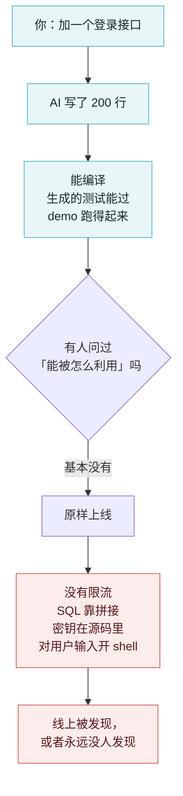
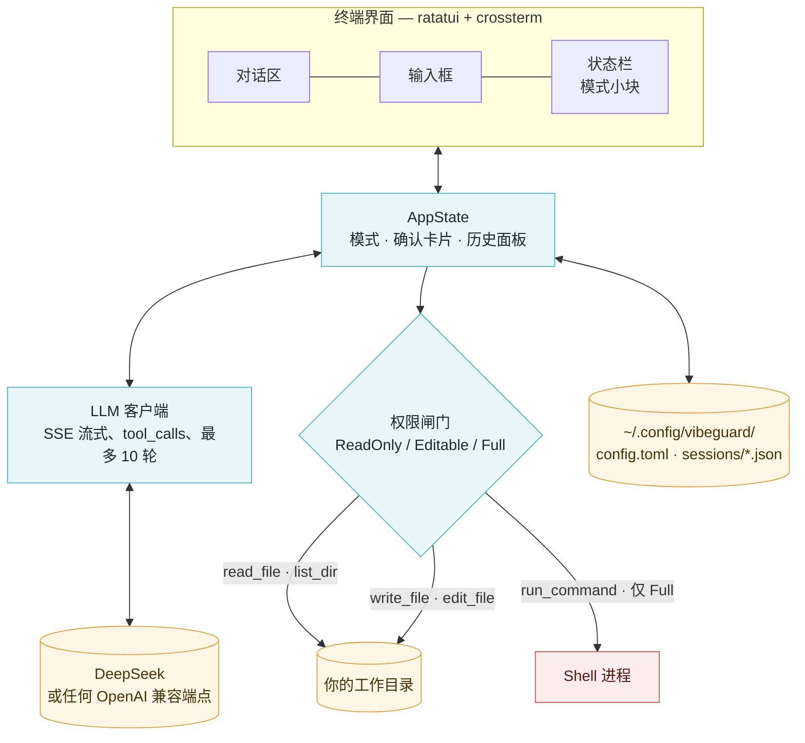
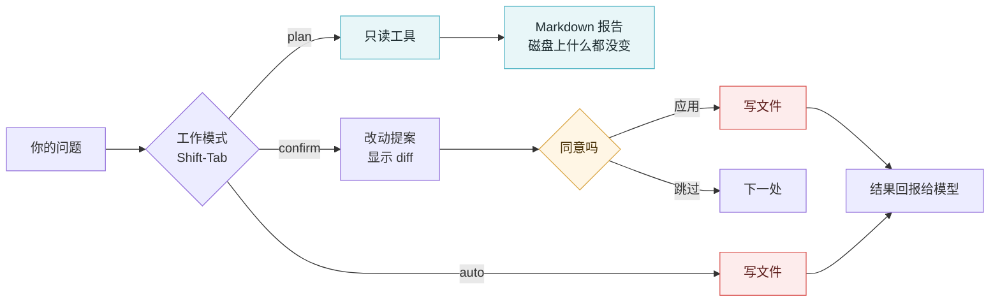

# VibeGuard — 交接文档

**AI 把代码写完了，却没人问一句「这玩意儿能被怎么利用」。这个工具就是为了补上这一问。**

[English](HANDOFF.md) · 中文


| | |
|---|---|
| 版本 | `0.1.0` |
| 运行时 | Rust 2024，单个二进制，没有常驻进程 |
| 模型 | 默认 DeepSeek，任何 OpenAI 兼容端点都能接 |
| 数据 | `~/.config/vibeguard/`，配置 + 每个对话一个 JSON，权限 `0600` |
| 最后更新 | 2026-10-23 |

---

## 1. 为什么做这个

我大部分项目都是跟 AI 聊出来的。确实快——以前要写一下午的功能，现在二十分钟就落地了。但事后回头看，生成出来的代码有个共同的「形状」：happy path 写得很漂亮，unhappy path 默认是别人的问题。

同一个类型的毛病，在我自己的仓库里反复出现：

- **登录 / 注册 / 找回密码没有速率限制**。一个脚本可以慢慢试一万个密码，没有任何东西拦它。
- **SQL 用字符串拼**——`"SELECT * FROM users WHERE id = " + id`。因为这样写比参数化查询更顺手。
- **密钥直接写死在源码里**。API key 粘进配置文件，然后被一起提交，理由是「回头再挪到环境变量」。
- **对请求参数用 `shell=True`、`eval`、`exec`**。因为从「跑一下」到「跑通了」最短的路，是拼一条 shell 命令。
- **新加的接口忘了鉴权**。AI 很乐意给你加一个 `/api/admin/export`，但没人让它加角色校验，它就不加。

真正让人不舒服的是**它们为什么能活下来**。代码能编译，AI 顺手写的测试能过，demo 也跑得起来。整条开发流程里，没有任何一环会问那句最关键的话——**这东西能被怎么利用？** linter 管风格，类型检查管形状，测试只管作者已经想到的情况。没有一环在模拟攻击者。



VibeGuard 就是对这道缝的回应：速度不变，把缺的那一问塞回流程里。它是一个终端工具，读你刚生成的那段代码，用人话讲清楚哪里不对，然后——如果你允许——把修复写进去。

### 工具自己不能变成漏洞

一个能改你文件、能跑 shell 命令的安全工具，本身就是一个攻击面；而驱动它的模型是个可以被说服的文本生成器。所以设计上有三条硬规矩：

1. **默认只读。** 权限模式默认 `readonly`，AI 只能读文件、出报告，写不了任何东西。
2. **每次写盘过两道闸。** 进程级的权限模式是一道，工作模式（plan / confirm / auto）是第二道。`plan` 连配置里给了全权限都能盖掉。
3. **Shell 要显式开，而且窄。** `run_command` 要求 `full` 权限，参数是数组不是 shell 字符串，删除类命令直接拒绝。

---

## 2. 现在能用什么

这点必须说准：对话内核是真的，扫描器是骨架。

| 部分 | 状态 |
|---|---|
| 全屏 TUI：对话区、输入框、状态栏、图片图标栏 | ✓ 可用 |
| 流式对话（OpenAI 兼容接口）+ 工具调用 | ✓ 可用 |
| 工具：`read_file`、`list_dir`、`write_file`、`edit_file`、`run_command` | ✓ 可用，受权限闸门约束 |
| 三种工作模式，confirm 有真正的「先问再写」握手 | ✓ 可用 |
| 对话持久化、内存内搜索、删除 | ✓ 可用 |
| 主题（dark / light）与字形风格（default / anime） | ✓ 可用 |
| `vibeguard config show / init / set`、`vibeguard ping` | ✓ 可用 |
| `/scan [路径]`：410 条清单里的 20 条本地规则 | ✓ 可用，只读，给出 `文件:行号` + CWE |
| `/scan --ai`：模型逐条判定剩下的约 323 条安全类条目，60 条一批。N/O/Q/S（依赖、云、日志、代码质量）默认跳过，`--all` 才跑 | ✓ 可用，烧 token |
| `/fix`：模型写修复、你看 diff、确认后才落盘 | ✓ 可用，不确认就不写 |
| `/report`：`vibeguard-report.md` + `.json`，两份都写明覆盖面 | ✓ 可用 |
| `/findings`：载入某目录上次的扫描结果，带逐文件的过期判断 | ✓ 可用 |
| 增量 `/scan --ai`：没改动的仓库 0 次请求，改一个文件 3 次 | ✓ 可用 |
| `/demo`：扫描 → 报告 → 逐条确认修复的界面 | ~ 只有示例数据，不读写任何文件 |
| CI、打包、许可证 | ✗ 还没有 |

410 条清单在 `assets/checklist.tsv` 里（由源文档生成，编译进二进制）。`/scan` 会明确报告这次覆盖了多少条——「没问题」和「没看过」不能长得一样。

---

## 3. 快速开始

```bash
git clone https://github.com/lindenthomaslin/vibeguard.git
cd vibeguard
cargo build --release            # 产物在 target/release/vibeguard

export DEEPSEEK_API_KEY=sk-...   # 或者：vibeguard config init
./target/release/vibeguard       # 进入交互模式
```

没配 Key 时第一次启动只会提示一句，不会直接失败。配置在 `~/.config/vibeguard/config.toml`，可以用 `--config FILE` 或 `$VIBEGUARD_CONFIG` 指到别处。

```bash
vibeguard config show                  # 打印生效配置，Key 是打码的
vibeguard config set model deepseek-reasoner
vibeguard config set permission_mode editable
vibeguard ping                         # 跟端点走一个来回
```

---

## 4. 架构

一个进程，一个 UI 线程，每个请求一个任务。用户看到的所有东西都走同一条消息通道，所以流式输出再快也追不上重绘。



一次请求的生命周期：键盘线程往通道里发 `Msg::Term`，定时器发 `Msg::Tick`，后台任务发 `Msg::Content` / `Msg::Diff` / `Msg::Proposal` / `Msg::Done`。每条消息都带着发起时的请求编号，取消之后迟到的消息会被丢掉，不会把对话区搞乱。

---

## 5. 权限模型

两道互相独立的闸：第一道是进程级的，写在配置里；第二道是会话级的，键盘随时能切。



| 模式 | 左下角 | 系统提示词里的约定 | 工具闸门 |
|---|---|---|---|
| `plan` | `○ plan · 只读` | 只读分析，最后输出一份 Markdown 漏洞报告 | 强制 `ReadOnly`；写工具直接回一句拒绝，模型才会继续写报告。查看类命令（`rg`、`find`、`ls`、`cat`、`git log`）放行，所以是搜仓库而不是逐个读文件 |
| `confirm` | `◇ confirm` | 一次只改一处 | 每次写盘都停在 `oneshot` 上等你答复——问题挂在屏幕上时，文件确实一个字节都没动 |
| `auto` | `◆ auto` | 一路做完 | 直接写，仍受权限模式约束 |

confirm 那个握手是这段代码里最值得看的地方：`start_chat` 发一条带回复通道的 `Msg::Proposal`，然后 `.await`。答复没到之前什么都不写；「本次全部应用」是个 `AtomicBool`，每个请求开头重置。

---

## 6. 快捷键

| 按键 | 作用 |
|---|---|
| `Enter` | 发送 |
| `Ctrl-J` / `Shift-Enter` | 换行 |
| `Shift-Tab` / `Ctrl-P` | 循环切换工作模式 |
| `Ctrl-T` | 深色 / 浅色切换 |
| `Esc` | 取消正在跑的请求 |
| `PgUp` / `PgDn`、`Ctrl-B` / `Ctrl-G` | 滚动对话区 / 跳到首尾 |
| `Ctrl-D` | 退出 |

历史对话面板（`/sessions`、`/search`）里：

| 按键 | 作用 |
|---|---|
| 直接输入 | 按标题和正文过滤 |
| `↑` / `↓` | 选择 |
| `Enter` | 打开这个对话 |
| `Del` 两下 | 删除——第一下只是问一句 |
| `Esc` | 关闭 |

---

## 7. 配置

`~/.config/vibeguard/config.toml`，权限 `0600`。每一项也能用 `vibeguard config set <key> <value>` 改：

| 键 | 默认值 | 说明 |
|---|---|---|
| `api_key` | 无 | `$DEEPSEEK_API_KEY` 会覆盖它 |
| `base_url` | `https://api.deepseek.com` | 任何 OpenAI 兼容的 base URL |
| `model` | `deepseek-chat` | 要推理模型就换 `deepseek-reasoner` |
| `thinking` | `auto` | `auto` / `off` / `low` / `high` / `max` |
| `temperature` | `0.0` | 审计要的是确定性 |
| `max_tokens` | 不设 | 用端点默认值 |
| `timeout_secs` | `120` | 单个请求 |
| `max_tool_rounds` | `120` | 一轮对话最多几次工具调用，到顶会停下并问要不要继续 |
| `permission_mode` | `readonly` | `readonly` / `editable` / `full` |
| `workspace_root` | 不设 | 限定工具能碰的路径 |
| `theme` | `dark` | `dark` / `light` |
| `font_style` | `default` | `default` / `anime` |
| `lang` | `en` | `en` / `zh`——界面语言，`/lang zh` 运行时切换 |

### 界面语言

默认英文，`/lang zh` 切中文并记住。文案在调用处仍写成中文，外面包一层 `i18n::tr("…")`，
由 `src/i18n/strings.rs` 查出英文；查不到就原样返回中文——漏译只露一句中文，不会 panic。
带插值的用 `i18n::pick(format!(zh), format!(en))`。

表有两个测试守着：不许有重复键、不许空译文，并且两种语言的 `{}` 个数必须一致
（不一致会在运行时 panic，编译期看不出来）。给模型看的提示词故意不翻——那是指令，不是界面。

---

## 8. 数据与隐私

- API Key 以 `0600` 存盘，界面上永远打码——`config show` 打印的是 `sk-…cdef`。
- 对话一个会话一个 JSON，放在 `~/.config/vibeguard/sessions/`，同样 `0600`。里面有你的提问、模型的回答，以及模型读过的文件内容。
- **会离开这台机器的**：你的提问、对话历史、模型主动读过的文件内容——发到你配的那个 `base_url`。别的没了。
- 没有遥测，没有其他上传。

---

## 9. 目录结构

```
src/
  main.rs        CLI 入口、子命令、图形能力探测
  app.rs         App + 运行时覆盖项（模型、思考力度）与配置持久化
  config.rs      配置结构、校验、0600 写入
  i18n.rs        语言开关（En/Zh）与 `tr()`：中文原文当键，查英文
  i18n/strings.rs  翻译对照表，一条消息一行
  llm.rs         OpenAI 兼容客户端：SSE、tool_calls、重试
  tui/
    mod.rs       事件循环、消息通道、后台任务
    state.rs     AppState：按键 → 动作、浮层、模式
    view.rs      纯绘制（ratatui），不碰终端
    layout.rs    矩形计算，可单测
    form.rs      /model 表单
    sessions.rs  历史对话面板：过滤、选择、删除
  sessions.rs    对话存储：保存、读取、目录索引、删除
  tools.rs       read_file / list_dir / write_file / edit_file / run_command + 权限闸门
  mode.rs        plan / confirm / auto —— 提示词约定与闸门
  theme.rs       色板 + 字形集：dark/light × default/anime
  chat.rs        对话条目与渲染
  editor.rs      输入缓冲与命令补全
  icon.rs        品牌图 → 终端字符格（四分之一方块兜底）
  graphics.rs    终端图形能力探测
  review.rs      逐条修复的状态机
  scan_ui.rs     漏洞卡片、扫描报告与 diff 渲染
  scan.rs        本地规则引擎：遍历、匹配、`文件:行号`、忽略标记
  vuln_checklist.rs  410 条清单，从 assets/checklist.tsv 解析
  repl.rs        非交互兜底（按行读，没有 TUI）
bench/
  fixtures/      一个样例仓库，每条本地规则各埋一处
  expected.tsv   手工维护的期望值——`cargo test bench` 算准召
assets/
  checklist.tsv  清单本体——编号、级别、分类、检测点、修复要点、CWE
  vibe-coding-checklist.md  生成 TSV 的源文档
```

---

## 10. 开发

```bash
cargo build
cargo test          # 259 通过；2 个已知失败在死掉的扫描器模块里
cargo clippy --all-targets
```

几条值得守住的约定：

- **`state.rs` 不碰终端，`view.rs` 不改状态。** 界面能不开 pty 就测，靠的就是这条。
- **能写成纯函数的一律写成纯函数。** 布局、diff、折叠、按显示宽度截断，都有单测。
- **模式不是一个标签。** 加任何跟模式有关的行为，`Mode::instruction()` 和工具闸门**两处都要改**，否则两边迟早对不上。

---

## 11. 已知缺口与下一步

1. **没有许可证。** 严格说这个仓库现在是「保留所有权利」。
2. **`run_command` 没有沙箱。** 要显式开、也挡删除，但在 `full` 权限下一段有耐心的提示词照样能干坏事。这里该有路径和命令白名单。
3. **同时只能开一个对话。** 打开历史会替换当前的。
4. **运行时那一层没覆盖。** 410 条里约 158 条只能对着跑起来的服务发请求才能确认，工具会把它们标成「无法判断」然后停在这里。
5. **增量那一步仍然会把每条都问一遍。** 它压缩的是模型**看到**的东西（只给变过的文件）和请求数（3 次而不是 7 次），但条目跳不掉：任何一个新写出来的文件都可能命中任意一条。要按条目跳，得先有「条目 → 文件」的映射，而清单里没有这个信息。

---

## 12. 依赖踩坑记录（都是真金白银换的，别删）

- `reqwest 0.13`：TLS 的 feature 叫 `rustls`，**不是** `rustls-tls`。这个改名能吃掉一小时。
- `similar 3.2`：`TextDiff::from_lines(old, new)`、`.iter_all_changes()`、`.grouped_ops(n)`、`.unified_diff()`；`Change` 上有 `tag()`、`value()`、`old_index()`、`new_index()`。
- `toml 1.1`：`toml::from_str` / `toml::to_string_pretty`。
- `dialoguer 0.12`：`Confirm` / `Select` / `Input` / `Password` 都是 `.with_prompt().default().interact()`；`Password` 的 feature 默认就开着。
- `indicatif 0.18`：`ProgressBar::new_spinner()`、`enable_steady_tick`、`set_message`、`suspend`、`println`；样式用 `ProgressStyle::with_template`。
- `console 0.16`：`style()`、`measure_text_width`、`truncate_str`。
- `ratatui 0.30` + `crossterm 0.29`：终端把 Shift-Tab 报成 `BackTab`；`KeyEventKind::Release` 必须过滤掉，否则每个键都触发两次。
- **pty 测试的坑：** 用伪终端驱动 TUI 时，必须回应光标位置查询（`ESC [ 6 n`），回一个 `ESC [ 34 ; 1 R` 之类。`Terminal::clear()` 会一直等这个回复，而真实终端一定会答。

---

## 13. 接手的话

冷启动按这个顺序读：`mode.rs`（工具承诺了什么）→ `tui/mod.rs::start_chat`（一个请求到底怎么跑）→ `tools.rs`（写盘在哪里被拦住）。其余都是表现层。

唯一不能破的约定：**用户没看过的东西，一个字节都不许落盘。** 这里其他所有设计选择，都是这句话的下游。
