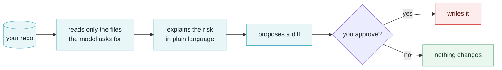

<div align="center">
  
</div>

<h1 align="center">VibeGuard</h1>

<p align="center">
  <b>AI writes the code. Nobody asks whether it can be abused.</b><br>
  <sub>A terminal security reviewer for vibe-coded projects — it explains the risk, proposes the fix, and writes nothing until you say so.</sub>
</p>

<p align="center">
  
  
  
  
</p>

<p align="center">
  <a href="HANDOFF.md">Handoff</a> ·
  <a href="README.zh-CN.md">中文</a>
</p>

---

## The problem

Code written by talking to an AI is optimistic. It does the happy path beautifully and treats
the unhappy path as someone else's problem. The same defect classes keep showing up:

- **No rate limiting** on login, signup, password reset
- **SQL built by string concatenation** instead of parameters
- **Secrets inline** in source, committed with the rest
- **`shell=True` / `eval` / `exec`** on values that came from a request
- **Missing authorization** on endpoints the AI added five minutes ago

And they survive review because the code compiles, the generated tests pass, and the demo works.
Nothing in the normal loop asks the one question that matters: **can this be abused?**

## How it works



Three work modes, cycled with `Shift-Tab` and shown in the bottom-left corner:

| Mode | What it does |
|---|---|
| `○ plan` | Read-only. Reads code, produces a vulnerability report, touches nothing on disk |
| `◇ confirm` | Shows each change as a diff and parks on a `oneshot` channel until you answer — the file is provably untouched while the question is on screen |
| `◆ auto` | Fixes without interrupting |

The permission model is deliberately paranoid: the default mode is `readonly`, `plan` overrides
even a config that granted full access, and `run_command` requires `full` permission *and* refuses
delete commands. A security tool that can rewrite your files is itself an attack surface.

## Install

```bash
git clone https://github.com/lindenthomaslin/vibeguard.git
cd vibeguard
cargo build --release

export DEEPSEEK_API_KEY=sk-...   # or: vibeguard config init
./target/release/vibeguard
```

Any OpenAI-compatible endpoint works — set `base_url` in `~/.config/vibeguard/config.toml`:

```bash
vibeguard config set base_url https://api.deepseek.com
vibeguard config set model deepseek-reasoner
vibeguard config set permission_mode editable
vibeguard ping
```

## Status

Early, but no longer a demo. Working today:

- streaming chat, five permission-gated tools, the three work modes
- conversation history with in-memory search and delete
- **`/scan [path]`** — 20 local rules drawn from the 410-item checklist: hardcoded secrets,
  `shell=True`, `eval`, SQL concatenation, ECB mode, `innerHTML`, `CORS *`, Dockerfile running as
  root, and so on. Every hit carries `file:line` and a CWE id. Read-only, no tokens spent.

The remaining ~390 checklist items need the model to read the code and judge — that pass is the
next milestone. Until it lands, `/scan` tells you exactly what it covered, so you can tell the
difference between "clean" and "not looked at".

## Docs

- **[HANDOFF.md](HANDOFF.md)** — why this exists, architecture diagrams, the permission model,
  configuration, known gaps, and the dependency notes worth keeping
- [中文文档](HANDOFF.zh-CN.md)

## License

Not chosen yet. Ask before you redistribute.
