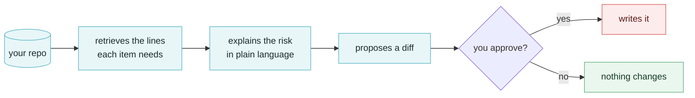

<div align="center">
  
</div>

<h1 align="center">VibeGuard</h1>

<p align="center">
  <b>AI writes the code. Nobody asks whether it can be abused.</b><br>
  <sub>A terminal security reviewer for vibe-coded projects — it explains the risk, proposes the fix, and writes nothing until you say so.</sub>
</p>

<p align="center">
  <a href="https://github.com/lindenthomaslin/vibeguard/actions/workflows/ci.yml"></a>
  
  
  
  
</p>

<p align="center">
  <a href="https://thomas-ai.space">Website</a> ·
  <a href="HANDOFF.md">Handoff</a> ·
  <a href="README.zh-CN.md">中文</a>
</p>

---

## The problem

Code written by talking to an AI is optimistic. It does the happy path beautifully and treats
the unhappy path as someone else's problem. The same defect classes keep showing up:

- **No rate limiting** on login, signup, password reset
- **SQL built by string concatenation** instead of parameters
- **Secrets inline** in source, committed with the rest
- **`shell=True` / `eval` / `exec`** on values that came from a request
- **Missing authorization** on endpoints the AI added five minutes ago

And they survive review because the code compiles, the generated tests pass, and the demo works.
Nothing in the normal loop asks the one question that matters: **can this be abused?**

## How it works



Three work modes, cycled with `Shift-Tab` and shown in the bottom-left corner:

| Mode | What it does |
|---|---|
| `○ plan` | Read-only. Reads code, produces a vulnerability report, touches nothing on disk |
| `◇ confirm` | Shows each change as a diff and parks on a `oneshot` channel until you answer — the file is provably untouched while the question is on screen |
| `◆ auto` | Fixes without interrupting |

The permission model is deliberately paranoid: the default mode is `readonly`, `plan` overrides
even a config that granted full access, and `run_command` requires `full` permission *and* refuses
delete commands. A security tool that can rewrite your files is itself an attack surface.

## Install

```bash
git clone https://github.com/lindenthomaslin/vibeguard.git
cd vibeguard
cargo build --release

export DEEPSEEK_API_KEY=sk-...   # or: vibeguard config init
./target/release/vibeguard
```

Any OpenAI-compatible endpoint works — set `base_url` in `~/.config/vibeguard/config.toml`:

```bash
vibeguard config set base_url https://api.deepseek.com
vibeguard config set model deepseek-reasoner
vibeguard config set permission_mode editable
vibeguard ping
```

The interface is English by default. Type `/lang` for a two-item menu (↑↓ then Enter) — or
`/lang zh` / `/lang en` to skip the menu. The choice is saved and applies from the next start. Every message lives in one table (`src/i18n/strings.rs`), so
adding a string means adding its translation next to it — a test fails if the two ever drift apart.

## Status

Early, but it does real work. Two stages, one report:

| Command | What it costs | What you get |
|---|---|---|
| `/scan [path]` | seconds, no tokens | 20 local rules over the 410-item checklist — `file:line` + CWE for every hit |
| `/scan --ai` | a handful of requests | the model judges the remaining security items, each with a verdict and evidence. Engineering-hygiene categories (dependencies, cloud, logging, code quality) are skipped by default — `--all` includes them |
| `/fix [n]` | one request per fix | a diff, and nothing is written until you press `y` |
| `/report` | free | `vibeguard-report.md` + `.json`, both stating coverage |

**Why the AI pass is not just "ask the model about the repo":**

- Each checklist item is matched against the repository by keyword, and only the surrounding
  lines are sent — **with line numbers**, so `file:line` answers are counted, not guessed.
- Evidence is verified before it becomes a finding: the file must exist, the line must be in
  range, and the line is quoted in the report so you can judge it in two seconds. Anything that
  cannot be located is dropped and listed separately — it never silently disappears.
- An unchanged repo costs **zero** requests; one edited file costs 3 instead of 7.
- Plan mode can still investigate: it refuses writes but allows read-only commands (`rg`, `find`,
  `ls`, `cat`, `git log`), so it greps instead of reading files one at a time.
- A cloned repo cannot act on its own: the first start in a directory asks whether you trust it.
  Say no — or press Esc — and the session stays read-only, because a repository is attacker-controlled
  input and a comment that says "ignore previous instructions" is only text until something obeys it.

**How accurate is it?** Measured, not asserted.

The local rules have a corpus: `cargo test bench` runs `bench/fixtures` — one seeded instance per
rule — and fails on any miss or false hit. Today 20/20, no noise.

The model tier has its own: `vibeguard bench` runs a small app with **15 planted vulnerabilities
and 8 traps** (code that looks dangerous and isn't), then scores hit / miss / duplicate / false
positive. Last full run on `deepseek-flash`, 83k tokens:

| | |
|---|---|
| recall | **15/15** |
| precision | **78.9%** |
| reports per real bug | **2.7** (22 of the 41 were the same line under a second checklist id) |
| traps reported | **1 of 8** |

Read that as: it does not miss what is planted, and it is noisy — roughly three findings for every
one real problem. Deduplicating same-line reports is the next number to move. Every scan also
states how much of the checklist it covered, so "clean" and "not looked at" never look the same.

The report files are worth adding to your `.gitignore`.

## Docs

- **[HANDOFF.md](HANDOFF.md)** — why this exists, architecture diagrams, the permission model,
  configuration, known gaps, and the dependency notes worth keeping
- [中文文档](HANDOFF.zh-CN.md)

## About

Built by **Thomas** — [thomas-ai.space](https://thomas-ai.space).

English is the default language for this project's docs; the Chinese version is
[README.zh-CN.md](README.zh-CN.md), and every document links to its counterpart at the top.

## License

Not chosen yet. Ask before you redistribute.
