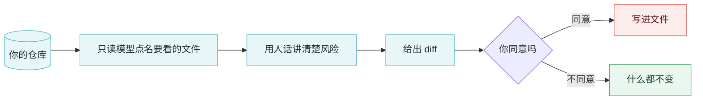

<div align="center">
  
</div>

<h1 align="center">VibeGuard</h1>

<p align="center">
  <b>AI 把代码写完了，却没人问一句「这玩意儿能被怎么利用」。</b><br>
  <sub>给 vibe coding 项目用的终端安全审阅器：讲清楚风险、给出修复，但你不点头，它一个字节都不写。</sub>
</p>

<p align="center">
  <a href="https://github.com/lindenthomaslin/vibeguard/actions/workflows/ci.yml"></a>
  
  
  
  
</p>

<p align="center">
  <a href="HANDOFF.zh-CN.md">交接文档</a> ·
  <a href="README.md">English</a>
</p>

---

## 要解决的问题

跟 AI 聊出来的代码是乐观的：happy path 写得很漂亮，unhappy path 默认是别人的问题。同样的毛病反复出现：

- 登录、注册、找回密码**没有速率限制**
- **SQL 用字符串拼**，不用参数化
- **密钥写死在源码里**，跟着一起提交
- 对请求参数用 **`shell=True` / `eval` / `exec`**
- AI 五分钟前刚加的接口，**忘了鉴权**

这些能活下来，是因为代码能编译、生成的测试能过、demo 跑得起来。整条流程里没有一环会问那句最关键的话：**这东西能被怎么利用？**

## 它怎么工作



三种工作模式，`Shift-Tab` 循环切换，左下角常驻显示：

| 模式 | 行为 |
|---|---|
| `○ plan` | 只读。读代码、出一份漏洞报告，磁盘上什么都不动 |
| `◇ confirm` | 每处改动先显示 diff，然后停在 `oneshot` 上等你答复——问题挂在屏幕上时，文件确实一个字节都没动 |
| `◆ auto` | 不打断，直接改 |

权限模型是故意偏执的：默认 `readonly`，`plan` 连配置里给了全权限都能盖掉，`run_command` 要求 `full` 权限**并且**拒绝删除类命令。一个能改你文件的安全工具，本身就是一个攻击面。

## 安装

```bash
git clone https://github.com/lindenthomaslin/vibeguard.git
cd vibeguard
cargo build --release

export DEEPSEEK_API_KEY=sk-...   # 或者：vibeguard config init
./target/release/vibeguard
```

任何 OpenAI 兼容端点都能接，改 `~/.config/vibeguard/config.toml` 里的 `base_url`：

```bash
vibeguard config set base_url https://api.deepseek.com
vibeguard config set model deepseek-reasoner
vibeguard config set permission_mode editable
vibeguard ping
```

## 当前状态

早期，但已经不是演示了。现在能用的：

- 流式对话、五个受权限约束的工具、三种工作模式
- 历史对话：内存内搜索、可删除
- **`/scan [路径]`**——从 410 条清单里挑出 20 条能用代码特征直接命中的：硬编码密钥、
  `shell=True`、`eval`、SQL 拼接、ECB 模式、`innerHTML`、`CORS *`、Dockerfile 以 root 运行……
  每条都带 `文件:行号` 和 CWE 编号。只读，不烧 token。
- **`/scan --ai`**——再把剩下 390 条交给模型，每条都必须给出判定和证据：
  `存在 / 疑似 / 不存在 / 无法判断`。只能跑起来才能确认的（限流、爆破、越权）一律标「无法判断」，
  而不是悄悄放过。
- **只为变过的东西花钱。** 上次之后什么都没动 → 一次请求都不发；改了一个文件 → 模型只看那个文件，
  3 次请求而不是 7 次，其余文件的结论沿用。新证据永远优先；旧发现只有在它自己的文件变过时才作废。

- **`/fix [数量]`**——让模型给出每个文件的修复版本，显示 diff，你按 `y` 之前一个字节都不写。
  计划模式下照样给你看 diff，只是永远不落盘。确认期间文件被别人改过，会跳过而不是覆盖。

- **`/findings`**——从 `~/.config/vibeguard/scans/` 载入这个目录上次的扫描结果，不用重扫。
  扫描时记下了每个文件的内容哈希，所以它能告诉你哪些发现已经过期——`/fix` 会拒绝碰那些。
- **`/report`**——在扫描目录下写出 `vibeguard-report.md`（给人看）和 `vibeguard-report.json`
  （给 CI 看）。两份都写清楚覆盖面；某一批没跑成功时，两份都会明说「覆盖不完整」。

每次扫描都会说清楚覆盖了清单里的多少条——「没问题」和「没看过」不能长得一样。
报告文件建议加进 `.gitignore`。

## 文档

- **[交接文档 HANDOFF.zh-CN.md](HANDOFF.zh-CN.md)** —— 为什么做这个、架构图、权限模型、配置、已知缺口，以及那些真金白银换来的依赖踩坑
- [English](HANDOFF.md)

## 许可

还没定。转载或分发之前请先问一声。
