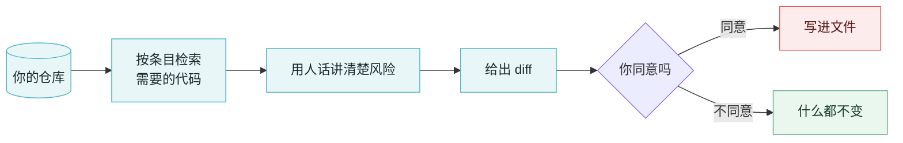

<div align="center">
  
</div>

<h1 align="center">VibeGuard</h1>

<p align="center">
  <b>AI 把代码写完了，却没人问一句「这玩意儿能被怎么利用」。</b><br>
  <sub>给 vibe coding 项目用的终端安全审阅器：讲清楚风险、给出修复，但你不点头，它一个字节都不写。</sub>
</p>

<p align="center">
  <a href="https://github.com/lindenthomaslin/vibeguard/actions/workflows/ci.yml"></a>
  
  
  
  
</p>

<p align="center">
  <a href="https://thomas-ai.space">官网</a> ·
  <a href="HANDOFF.zh-CN.md">交接文档</a> ·
  <a href="README.md">English</a>
</p>

---

## 要解决的问题

跟 AI 聊出来的代码是乐观的：happy path 写得很漂亮，unhappy path 默认是别人的问题。同样的毛病反复出现：

- 登录、注册、找回密码**没有速率限制**
- **SQL 用字符串拼**，不用参数化
- **密钥写死在源码里**，跟着一起提交
- 对请求参数用 **`shell=True` / `eval` / `exec`**
- AI 五分钟前刚加的接口，**忘了鉴权**

这些能活下来，是因为代码能编译、生成的测试能过、demo 跑得起来。整条流程里没有一环会问那句最关键的话：**这东西能被怎么利用？**

## 它怎么工作



三种工作模式，`Shift-Tab` 循环切换，左下角常驻显示：

| 模式 | 行为 |
|---|---|
| `○ plan` | 只读。读代码、出一份漏洞报告，磁盘上什么都不动 |
| `◇ confirm` | 每处改动先显示 diff，然后停在 `oneshot` 上等你答复——问题挂在屏幕上时，文件确实一个字节都没动 |
| `◆ auto` | 不打断，直接改 |

权限模型是故意偏执的：默认 `readonly`，`plan` 连配置里给了全权限都能盖掉，`run_command` 要求 `full` 权限**并且**拒绝删除类命令。一个能改你文件的安全工具，本身就是一个攻击面。

## 安装

```bash
git clone https://github.com/lindenthomaslin/vibeguard.git
cd vibeguard
cargo build --release

export DEEPSEEK_API_KEY=sk-...   # 或者：vibeguard config init
./target/release/vibeguard
```

任何 OpenAI 兼容端点都能接，改 `~/.config/vibeguard/config.toml` 里的 `base_url`：

```bash
vibeguard config set base_url https://api.deepseek.com
vibeguard config set model deepseek-reasoner
vibeguard config set permission_mode editable
vibeguard ping
```

界面默认英文，`/lang zh` 切成中文并记住这个选择，`/lang en` 切回去。所有文案集中在一张表
（`src/i18n/strings.rs`）里，加一条消息就在旁边加一句译文——两边对不上时测试会失败。

## 当前状态

早期，但已经在真干活了。两段扫描，一份报告：

| 命令 | 花多少 | 拿到什么 |
|---|---|---|
| `/scan [路径]` | 几秒，不烧 token | 410 条清单里的 20 条本地规则，每条命中都给 `文件:行号` + CWE |
| `/scan --ai` | 几次请求 | 模型判定剩下的安全类条目，每条都要给判定和证据。依赖、云、日志、代码质量这四类工程规范默认不判（`--all` 可以连它们一起跑） |
| `/fix [数量]` | 每个修复一次请求 | 先给你看 diff，你按 `y` 之前一个字节都不写 |
| `/report` | 免费 | `vibeguard-report.md` + `.json`，两份都写明覆盖面 |

**为什么 AI 判定不是「把仓库丢给模型」：**

- 每条清单项都会去仓库里按关键词检索，只发**命中位置附近的代码，并且带行号**——
  所以 `文件:行号` 是数出来的，不是猜的。
- 判定变成发现之前先核实证据：文件必须存在、行号必须在范围内，而且报告里会引
  **那一行的原文**，你两秒就能判断真假。核实不了的会被剔除并单独列出，不会悄悄消失。
- 没改动 → **0 次请求**；改了一个文件 → 3 次而不是 7 次。
- 计划模式也能查：拒绝写文件，但放行查看类命令（`rg`、`find`、`ls`、`cat`、`git log`），
  所以是拿 `rg` 搜仓库，而不是一个文件一个文件读。

**准不准？** 有数据，不是嘴上说。`cargo test bench` 跑一份手工标定的样例仓库
（`bench/fixtures`，每条本地规则各埋一处），漏报和误报都会让测试红——现在是 20/20，零噪音。
AI 那一层还没有标定集，所以把它的输出当**线索**，别当结论。每次扫描都会说清楚覆盖了
清单里的多少条——「没问题」和「没看过」不能长得一样。

报告文件建议加进 `.gitignore`。

## 文档

- **[交接文档 HANDOFF.zh-CN.md](HANDOFF.zh-CN.md)** —— 为什么做这个、架构图、权限模型、配置、已知缺口，以及那些真金白银换来的依赖踩坑
- [English](HANDOFF.md)

## 关于

本项目由 **Thomas** 开发 —— 官网：[thomas-ai.space](https://thomas-ai.space)。

文档默认英文（`README.md`），中文版是这份 `README.zh-CN.md`；每份文档顶部都能切到另一语言。

## 许可

还没定。转载或分发之前请先问一声。
